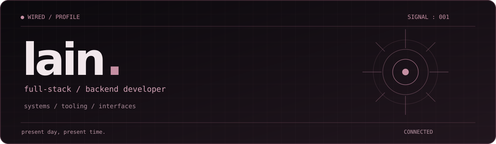

 

**developer of systems, tools, and interfaces.**

linux enthusiast · self-taught experimentation · thoughtful software design

  

`C++` &nbsp; `Luau` &nbsp; `Lua` &nbsp; `Python` &nbsp; `TypeScript` &nbsp; `JavaScript`

### `01 / about`

hey, i'm **lain**. i work on full-stack and backend software, linux tooling, and custom interfaces. i'm especially interested in low-level systems, reverse engineering, and making software feel as good as it functions.

outside of code: anime, music, and gaming on pc / ps5.

### `02 / selected work`

| project | focus |
| :--- | :--- |
| **iwakura** | a custom linux desktop experience: theming, session tools, and interface components |
| **lapse** | native c++ / luau tooling: sandboxed execution and runtime inspection |
| **semblance** | discord-first commission and marketplace workflows backed by typescript |

> some of my projects are works in progress. repository links will be added as they become public.

### `03 / toolkit`

| domain | tools & technologies |
| :--- | :--- |
| **languages** | C++, Lua, Luau, Python, JavaScript, TypeScript |
| **backend** | Node.js, PostgreSQL, discord.js |
| **systems** | Linux, Git, Bash, Fish |
| **interfaces** | Qt / QML, HTML, CSS |
| **exploring** | reverse engineering, runtimes, UI/UX |

### `04 / current signals`

- designing and refining **iwakura**
- developing **lapse**'s native tools
- building **semblance**'s Discord workflows

### `05 / contact`

for development discussions, collaborations, or commissions, reach out through my Discord profile linked on e-z.bio.

somewhere on the wired. / end of transmission

